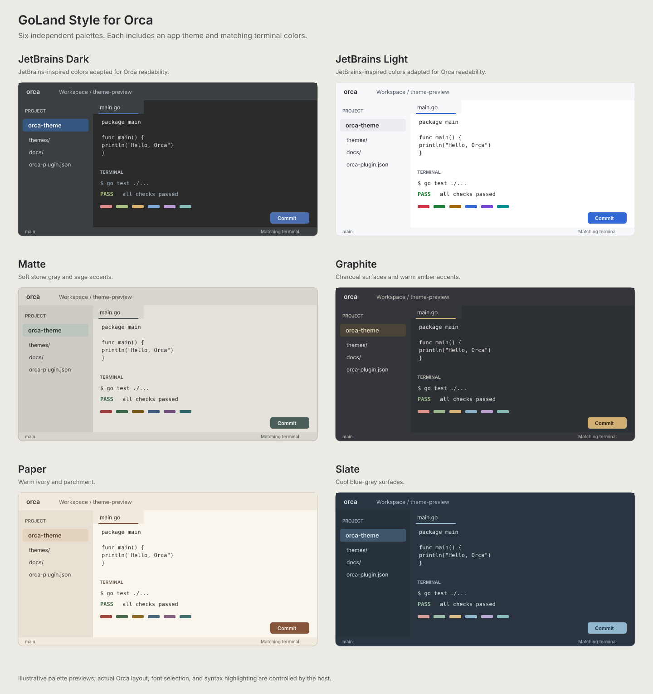

# Orca Theme Collection

Six independent color themes for the [Orca](https://github.com/stablyai/orca) app, each with a matching terminal palette. This is a declarative Orca plugin; it runs no code and requests no capabilities.

## Variants

| Theme | Appearance |
|---|---|
| JetBrains Dark | Original JetBrains Dark palette |
| JetBrains Light | Original JetBrains Light palette |
| Matte | Soft stone gray with a restrained sage accent |
| Graphite | Neutral charcoal with a warm amber accent |
| Paper | Warm ivory and parchment with an earthy accent |
| Slate | Cool blue-gray surfaces with a steel-blue accent |

Matte, Graphite, Paper, and Slate are original palettes. Each is a separate choice in Orca's theme picker. Matte uses solid, opaque color values; window blur and transparency are host settings configured separately.

## Install

1. In Orca, open **Settings → Plugins** and turn on the experimental plugin system.
2. Choose **Install plugin → Local folder** and enter the absolute path to this checkout (the folder containing `orca-plugin.json`).
3. Review and enable **Orca Theme Collection**.
4. Select any of the six themes in the appearance theme picker, then choose the same name under **Settings → Terminal**.

For a Git install, select **Git URL** and use `ssh://git@github.com/im-adarsh/orca.git#<full-commit-id>`. Use a complete 40-character commit ID from GitHub. To update an existing installation, keep the same plugin identity (`im-adarsh.jetbrains-themes`) and install the newer revision through Orca's plugin update flow.

Orca 1.4.244 or newer is required because the plugin uses app and terminal theme contributions available in that build.

## GoLand fonts and code colors

Follow the [GoLand appearance setup](docs/goland-setup.md) to use **Inter** for the interface and **JetBrains Mono** for the editor and terminal. Fonts are selected in Orca settings separately from the theme plugin.

## Accuracy and scope

The **JetBrains Dark** and **JetBrains Light** colors come from JetBrains' own [Dark UI theme](https://github.com/JetBrains/intellij-community/blob/master/platform/platform-resources/src/themes/expUI/expUI_dark.theme.json), [Light UI theme](https://github.com/JetBrains/intellij-community/blob/master/platform/platform-resources/src/themes/expUI/expUI_light.theme.json), [Dark editor scheme](https://github.com/JetBrains/intellij-community/blob/master/platform/platform-resources/src/themes/expUI/expUI_darkScheme.xml), and [Light editor scheme](https://github.com/JetBrains/intellij-community/blob/master/platform/platform-resources/src/themes/expUI/expUI_lightScheme.xml). The main surfaces, text, accents, selection, and ANSI colors use values from those files.

Orca exposes a fixed set of color tokens, so this reproduces the JetBrains palettes within Orca's existing interface. It cannot change Orca's layout, icons, typography, or every control color to make the app pixel identical to a JetBrains IDE. The terminal's 16 ANSI colors map JetBrains' named palette hues to terminal roles; JetBrains' editor scheme is not itself a terminal ANSI theme.

## Files

- `orca-plugin.json` — plugin manifest and theme registrations
- `themes/*.json` — six full app palettes and their six matching terminal palettes
- `previews/themes.svg` — comparison sheet generated from the palette values

The theme API is currently experimental in Orca, so its schema may change in later versions.
