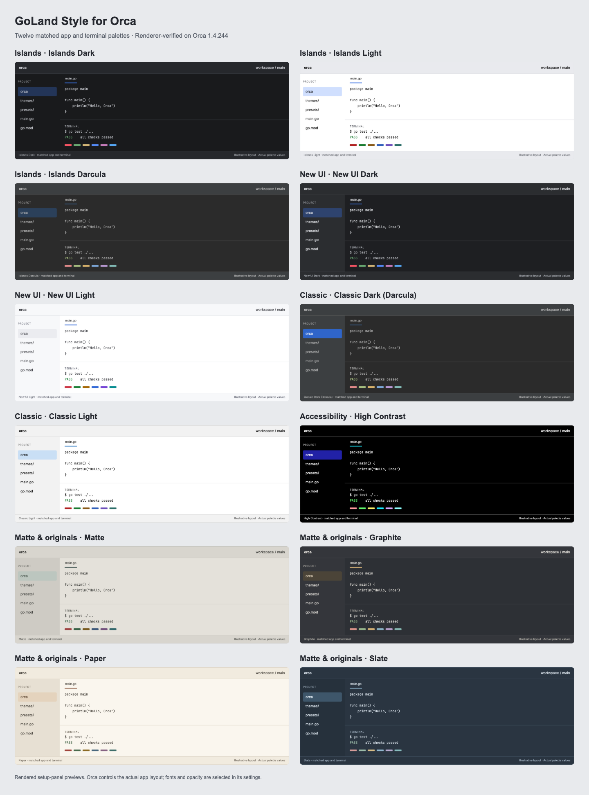

# Adarsh Orca Marketplace

A marketplace with JetBrains-style file icons, and twelve matched app/terminal palettes for IntelliJ and GoLand users: Islands, New UI, Classic, High Contrast, and four matte alternatives. Both light and dark modes are included.



## Install on any laptop

Requires **Orca 1.4.244 or newer**. In **Settings → Plugins → Marketplace sources**, enter:

- **Git URL:** `https://github.com/im-adarsh/orca.git`
- **Git ref:** `main`

Add the source, install **GoLand Style for Orca**, review it, and enable it. The index pins the plugin to immutable release `v1.5.2`. Public downloads use HTTPS, so a GitHub SSH key is unnecessary. This is a personal marketplace published by `im-adarsh`.

Already added the source? Refresh it before updating. The development Git remote remains SSH. Direct installation also works with **Install plugin → Git URL**: `https://github.com/im-adarsh/orca.git#v1.5.2`. For **Local folder**, supply an absolute filesystem path to this checkout, not a Git URL.

If Install says “Could not prepare this plugin for review,” follow [the installation troubleshooting guide](docs/install-troubleshooting.md).

## Marketplace packages

The current source removes **Developer Commands** and **Agent Profiles**, including their launcher, presets, panel sources, and dedicated tooling. The theme collection now contributes only **GoLand Setup** and requests no workspace or terminal permissions. Release **v1.5.2** keeps the manifest compatibility fix and removes the custom app work. Refresh your marketplace source and update the theme package to remove them from an older installation.

The newer catalog includes **JetBrains File Icons** (four variants), gated to **Orca 1.4.245+**. Install **Excalidraw** from Orca’s official catalog; personal catalogs cannot list official plugin identities. The latest stable host checked was 1.4.244, so those packages are prepared but cannot yet be installed there. See [developer setup, compatibility, and verification](docs/developer-kit.md).

## Pick a family

| Family | Dark | Light | Character |
|---|---|---|---|
| Islands | Islands Dark; Islands Darcula | Islands Light | Deep neutral or Darcula surfaces with blue selections |
| New UI | New UI Dark | New UI Light | GoLand's modern charcoal editor and cool light counterpart |
| Classic | Classic Dark (Darcula) | Classic Light | Traditional Darcula charcoal or white surfaces with classic blue accents |
| Accessibility | High Contrast | — | Deliberate black surfaces, white text, cyan focus |
| Matte alternatives | Graphite; Slate | Matte; Paper | Amber charcoal, blue-gray, stone/sage, and ivory |

Each theme uses one base across app chrome, settings panels, popovers, sidebars, editor, and terminal. Islands Dark uses the inner-panel `#191A1C` throughout; New UI Dark uses `#1E1F22`; Classic Dark and Islands Darcula use `#2B2B2B`. Light JetBrains families use white throughout. Matte, Graphite, Paper, and Slate each use their own editor/terminal base across all major surfaces. Controls, selections, and focus indicators retain subtle contrast. Existing theme IDs are preserved: `jetbrains-dark` and `jetbrains-light` now explicitly display as New UI Dark and New UI Light.

[Actual Islands Dark Settings screenshot](previews/islands-dark-settings.png) · [Islands Light Settings screenshot](previews/islands-light-settings.png)

Each pair defines all **37 public app tokens** and **22 terminal colors**. Editor and terminal backgrounds match exactly. Normal dark families remain dark throughout; light families remain light throughout.

## Finish the setup

Open the plugin's **GoLand Setup** panel for previews and the portable checklist.

1. Select an app theme in Appearance and the **same name** for its terminal theme. Enable separate light/dark terminal themes and use the slot matching the theme's mode.
2. Set Background Opacity, Active Pane Opacity, and Inactive Pane Opacity to **100%**. Set Window Blur to **Off** and Left Sidebar Appearance to **Default**.
3. Clear terminal Color Overrides in both modes. Blank fields inherit the palette; an empty picker can display black without overriding the theme.
4. Install **Inter** and **JetBrains Mono** on each laptop. Select Inter/Inter Variable for the IDE, JetBrains Mono for editor and terminal.
5. Optionally enable Chat → Match terminal interface.

After updating, reselect the app and terminal themes to refresh saved colors. Start a fresh terminal if old TUI scrollback retains explicit background colors. See [the setup guide](docs/goland-setup.md) and [settings reference](presets/goland-style.json). The reference is a checklist; Orca cannot import it as global settings.

## What matches JetBrains

The palettes adapt official JetBrains editor/console colors from [Islands](https://github.com/JetBrains/intellij-community/tree/master/platform/platform-resources/src/themes/islands), [New UI](https://github.com/JetBrains/intellij-community/tree/master/platform/platform-resources/src/themes/expUI), [Darcula](https://github.com/JetBrains/intellij-community/blob/master/platform/platform-resources/src/themes/darcula.theme.json), and [Classic Light](https://github.com/JetBrains/intellij-community/blob/master/platform/platform-resources/src/themes/intellijlaf.theme.json). [Source identities and hashes](docs/palette-sources.json) record the inspected definitions. App surfaces are deliberately unified for consistency rather than copying JetBrains chrome/background differences. Some text and accent colors are adapted to Orca's enforced contrast thresholds. ANSI colors are terminal adaptations, not imported Go syntax highlighting.

**These are palette adaptations.** Orca's public theme API cannot install Islands rounded pane geometry, Classic toolbars, global toolbar icon replacement, global fonts, or GoLand `.icls` editor schemes. Its security dialogs deliberately use built-in colors. Fonts and host preferences must be selected separately. The [UI compatibility notes](docs/ui-compatibility.md) explain the scope of each family.

## Navigation

| Shortcut | Action |
|---|---|
| `Mod+Alt+1` | Toggle Project / Explorer |
| `Mod+Alt+9` | Toggle Version Control |
| `Mod+Alt+Shift+F` | Toggle Find in Project |

`Mod` is Command on macOS and Control on Windows/Linux. These helpers are not a full GoLand keymap; remap in Settings → Shortcuts. The theme plugin has no worker process and requests no host capabilities. GoLand Setup runs in Orca's sandboxed frame.

## Verify

With Node.js 22 or newer:

```sh
npm test
npm run verify:orca -- /Applications/Orca.app
npm ci
npm run test:browser
```

The dependency-free validator checks contrast, complete pairs, modes, family base anchors and equal major surfaces, and portable release URLs. Host verification executes the installed Orca color filter and validates its schemas. Browser tests check every palette, the actual host CSP wrapper, responsive widths, and initial theme matching. See [verification details and limits](docs/verification.md).

The repository contains the installable manifests, `themes/`, `setup/`, the `presets/` checklist, source/verification notes in `docs/`, validators in `scripts/`, and palette previews in `previews/`.
