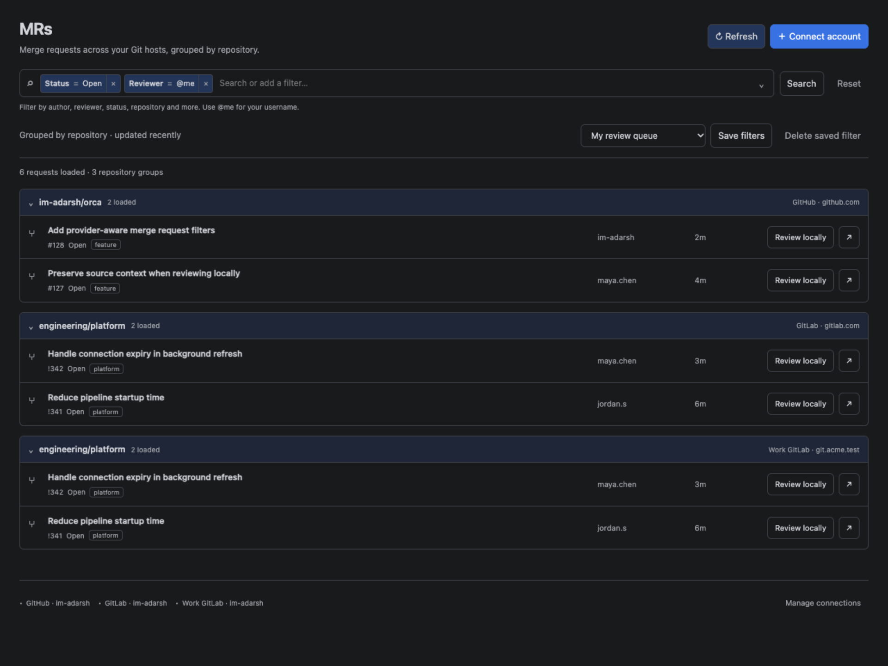

# Native MRs

MRs adds one entry below Tasks and Automations. Requests are grouped by repository, Git host and account. It supports GitHub, GitLab.com and HTTPS self-hosted GitLab, including nested groups and instance path prefixes. GitHub Enterprise uses its `/api/v3` endpoint.

The plugin and reproducible host patch live in **im-adarsh/orca**. Stock Orca does not expose the navigation/worker bridge this feature needs. This is a source-build delivery, not a published signed desktop release. The v1.5.0 tag publishes this source delivery and updated plugin indexes. Historical immutable releases retain their original hashes.



The screenshot uses sample accounts and requests. No private provider credentials were used in automated checks.

## Build the compatible host once

Use Node 24 and the pnpm version pinned in the host's `package.json`, plus the host's normal platform build prerequisites. From this marketplace checkout:

```sh
git clone https://github.com/stablyai/orca.git /absolute/path/orca-mrs-host
git -C /absolute/path/orca-mrs-host checkout 400266a9ce259337ec46836c2a8e18a449d49f4a
node scripts/prepare-mrs-host.mjs /absolute/path/orca-mrs-host
node scripts/prepare-mrs-host.mjs /absolute/path/orca-mrs-host --apply
```

The first script call checks compatibility without writing. The second verifies the patch's SHA-256, requires the exact base and a clean checkout, and applies it. Running it again detects that it is already applied. It never changes an installed application.

In the host checkout:

```sh
pnpm install --frozen-lockfile
pnpm build:desktop
```

The patched version is `1.4.245-mrs.1`. Start it using the host's normal `pnpm start` command with an explicit, separate user-data directory. On macOS/Linux, set `ORCA_USER_DATA_PATH=/absolute/path/orca-mrs-profile` for that command; on PowerShell set `$env:ORCA_USER_DATA_PATH` before starting. Keep the existing desktop installation and its profile separate while reviewing this custom build.

`host/contract.json` identifies the exact source base, patch hash and added features. No global package manager, source checkout or installed Orca is silently replaced by the preparation script.

## Install the plugin

In the patched host, refresh the im-adarsh/orca marketplace source and install **MRs**, or choose **Install plugin → Local folder**. Select the absolute `plugins/merge-request-inbox` directory in this checkout. Review its trusted-worker, private storage, encrypted secrets, own-worker, review-composer and link permissions, then enable it. **MRs** appears below Tasks and Automations; it does not create a right-sidebar tab or a second MR Inbox entry.

The GoLand theme package is independent. Its current source contains only GoLand Setup, palettes and navigation shortcuts, with no workspace or terminal permissions. The old Agent Profiles and Developer Commands files are removed from both source and generated packages. Updating a local plugin package is necessary to remove those panels from a previously installed version; deleting source does not rewrite a published release.

## Connect and filter

Select **Connect account**, choose a provider, enter a server URL, name and personal access token, then select **Test & connect**. GitHub defaults to `https://github.com`, GitLab to `https://gitlab.com`. For self-hosted GitLab use the instance's HTTPS root, for example `https://git.example.com` or `https://git.example.com/gitlab`.

Use provider tokens with read access to the requests/repositories you need. GitLab normally uses `read_api`; GitHub token permissions and selected repositories must allow reading private pull requests when applicable. The worker validates the authenticated identity before saving. Tokens live in Orca's encrypted plugin vault, are never returned to the panel, and are cleared from the input after connection. Saved views contain filters and connection ids, not credentials.

Use the single GitLab-style filter bar to add connection, status, draft, repository, author, assignee, reviewer, labels and text chips. Choose a field from the dropdown, enter or choose a value, then press Enter. Click a chip to edit it or × to remove it. Plain text searches titles and descriptions; shortcuts such as `author: maya.chen` also work. The current operator is equality.

User filters use provider usernames; `@me` resolves separately for each account. For your review queue add `Reviewer = @me`; use `Assignee = @me` or `Author = @me` for the other personal queues. These are filters rather than separate tabs. **Search** or Enter runs the query. Select **Save filters**, give the set a name, and restore it from **Saved filters** later. Saving the same name replaces that set. Saved sets persist across restarts and can be deleted.

Groups and counts describe loaded rows. **Load more** retrieves further results; a provider search cap or individual connection error is displayed explicitly. Identical repository names on different instances or accounts remain separate. Disconnect removes connection metadata and its encrypted credential.

## Review locally

Select **Review locally** on a request. Orca opens the same native workspace composer used by Tasks, with the MR linked, its local repository selected and a review prompt. Choose an agent and its chat or terminal surface, then create/start the review through the normal composer flow. Existing MR branch/base handling and agent startup remain owned by Orca.

The repository must already have one matching **local** checkout registered in Orca. If it is missing or ambiguous, the action gives add/clone guidance instead of selecting a different project. HTTPS instances on different ports are distinct. Git fetch/checkout and native provider metadata use the repository's existing Orca/Git authentication; the inbox token is not copied into a shell or another account's settings. When needed, configure that native repository connection as you would for Tasks.

The ↗ action opens the request in your browser. This release does not merge, approve, comment on or close requests.

## Rebuild and verify

```sh
npm ci
npm run build:mrs
npm test
npm run verify:orca -- /Applications/Orca.app
npm run test:mrs:browser -- /absolute/path/orca-mrs-host
node scripts/test-mrs-host.mjs /absolute/path/orca-mrs-host
```

Browser verification uses the host's real CSP shell and protocol with fixture provider responses. It covers account setup, token clearing, escaping remote titles, saved views, grouping, review handoff, refresh/disconnect races, responsive widths and all twelve palettes. It requires a local Chrome executable; set `CHROME_PATH` if it is not at the default macOS location.

For the real desktop smoke test, build the host with `pnpm build:electron-vite --mode e2e`, then run `npm run test:mrs:runtime -- /absolute/path/orca-mrs-host` here. The script reuses the host's E2E home isolation, installs/approves this local plugin only in its disposable profile, verifies one native entry and the worker's empty state, and checks the fallback when disabled. Every native window remains hidden. The captured [native screenshot](../previews/mrs-native-runtime.png) shows an empty profile; the grouped screenshot above uses provider fixtures.

In the host run `pnpm check:changed --maxWorkers=2`. Build and test processes that launch Orca must set `ORCA_BACKGROUND_LAUNCH=1`; use an isolated profile and hidden-renderer screenshots. The host's source instructions apply to the patch as well.

## Provider code

`providers.mjs` validates connections, resolves identity, compiles provider-specific filters and normalizes one API page. `model.mjs` validates portable filters and groups by account/host/repository. `worker.mjs` owns credentials, persistence and bound pagination cursors. `panel.html` is generated from the adjacent template/CSS/JS using `scripts/build-mrs-panel.mjs`; edit those sources and rebuild.

The plugin has no runtime dependencies and does not need `gh` or `glab` for listing. The host patch reuses Orca's sandbox frame, session approval, worker lifecycle and workspace composer. Other providers require a real adapter and tests before being advertised.

## Verification limits

The patched host builds successfully. All 884 plugin regression tests pass, along with the provider/worker and browser checks. The final host gate passed 40 of 41 checks; its broad related-test step was stopped at a two-minute limit after an earlier complete run exposed missing historical release tags, sandbox socket restrictions and a profile-transfer timeout. This is not a green full-host test run. Real private-account queries and Windows/Linux desktop startup remain unverified.

REA provenance and the exact checked build scope are recorded in `host/rea-verification.json`. REA inspected three selected built bridge/navigation files statically; the hidden desktop smoke test supplies separate runtime evidence. Installed Ponytail 5.3.2 guided reuse of Orca's existing frame, worker and composer paths.
