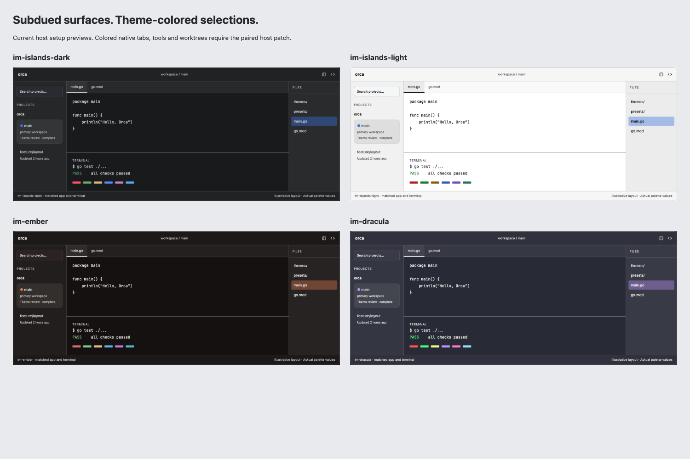
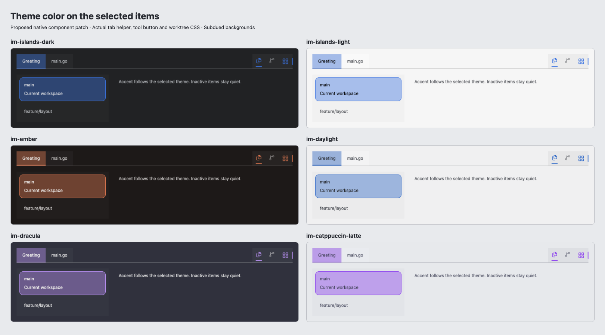

# Popular IDE palette collection

Version 1.8.1 contains 39 matched app/terminal pairs: 13 existing choices plus 26 adaptations across 16 established IDE-theme families. All displayed names use `im-`. This is a representative collection, not a claim to include every popular theme or an install-count ranking. Near-identical soft/hard/brightness presets were intentionally omitted.

| Family | Added choices |
|---|---|
| Dracula | `im-dracula` |
| One | `im-one-dark-pro`, `im-one-light` |
| Catppuccin | `im-catppuccin-mocha`, `im-catppuccin-latte` |
| Tokyo Night | `im-tokyo-night` |
| Nord | `im-nord` |
| GitHub | `im-github-dark`, `im-github-light` |
| Gruvbox | `im-gruvbox-dark`, `im-gruvbox-light` |
| Solarized | `im-solarized-dark`, `im-solarized-light` |
| Rosé Pine | `im-rose-pine`, `im-rose-pine-dawn` |
| Night Owl | `im-night-owl`, `im-night-owl-light` |
| Ayu | `im-ayu-dark`, `im-ayu-light` |
| Monokai | `im-monokai` |
| Kanagawa | `im-kanagawa-wave`, `im-kanagawa-lotus` |
| Material Palenight | `im-material-theme-palenight` |
| SynthWave 84 | `im-synthwave-84` |
| Default Plus | `im-dark-plus`, `im-light-plus` |

## Design and reconstruction evidence

REA 6.8.0 statically parsed all 26 selected shipped modules from the integrity-verified `@shikijs/themes@4.5.0` npm package without executing them. There were 0 parse failures. It did not analyze 107 other inventoried files and does not establish native IDE rendering. The portable complete Evidence is retained as `docs/rea/global-themes-evidence.json.gz`; the summary and immutable Evidence ID are in [source provenance](popular-theme-sources.json).

[Superdesign’s palette board](https://superdesign.dev/teams/0c240145-1aa6-49cc-bdae-c4fd918fc26f/projects/bd13ddbe-a7d2-433c-a254-5bb024280911?node=draft-variant-1a25da02-533d-4225-a235-27bc9e015639) proposed the 26 structural shade/accent directions. The generator rejects malformed colors and adapts the proposals to Orca readability and surface constraints. One malformed generated hex was corrected to a valid white raised surface; the correction is recorded in `presets/global-theme-design.json`. Source editor backgrounds are preserved. Shades, selections, focus colors, text and ANSI colors are intentional adaptations, not pixel-identical imports.

The prior review findings are addressed across all 39 palettes: stronger sidebar/editor separation, hue-tinted selections that do not depend on the removed preview stripe, and information-bearing ANSI colors tuned for 4.5:1 raw contrast. ANSI black/white semantics are retained; Orca also provides its own contrast correction. Some upstream themes omit ANSI colors; every fallback is listed in [adaptations](popular-theme-adaptations.json).

Package and original author notices are retained in [THIRD_PARTY_THEMES.md](../THIRD_PARTY_THEMES.md) and `licenses/`. One Dark Pro and One Light have separate original author notices. No original product logos or proprietary theme assets are bundled.

## Preview and installation

Open `setup/index.html` for grouped/searchable palette previews. Searching filters the choices while preserving the current palette; no-match searches give explicit feedback. Choose the same app and terminal name in Orca, then select `im-material-dark` or `im-material-light` independently. The existing shared icon packages work with all 39 palettes.

For Orca 1.4.245+, install the local folder `plugins/goland-style`. That generated package includes its licenses and provenance. The root manifest is the compatibility build for 1.4.244. Install one of those theme packages, not both. The published indexes retain versioned release pins; the section hierarchy update is packaged as legacy 1.8.0 / modern 2.4.0.

These contributions affect app/terminal palettes and supported file icons. They do not replace global toolbar icons, install native Islands geometry, or import editor syntax schemes. Final checks exercise installed parsers, the actual renderer filter and the sandboxed setup panel; they do not claim visual native-profile installation.

## Rebuild and verify

```sh
npm run generate:themes
npm run package:marketplace
npm test
npm run verify:orca -- /Applications/Orca.app
npm run verify:icons
npm run test:browser
```

Generation is offline and deterministic. Invalid external design colors are rejected before any generated artifact is written. Tests exercise all 39 pairs, source identity, licenses, selection/focus readability, grouped search, empty results and native host filtering.

## Section hierarchy review (1.8.0 / 2.4.0)

The previous generator assigned the same shade to the frame, project rail and explorer and tightly capped the surface range. Each now has its own role: accent-tinted frame, intermediate project rail, neutral explorer, original editor/terminal, tinted tabs/cards and a separate floating layer. Frame/content contrast is at least 1.4:1; rail/explorer contrast is at least 1.1:1. These are structural separation checks, not accessibility requirements for decorative surfaces. Text remains 4.5:1 and focus rings reach 3:1 across every major surface. No extra theme variants or duplicate palettes were added.

UI/UX Pro Max’s active-state guidance informed the section hierarchy and selection treatment. REA 6.8.0 statically inspected two selected installed host modules with zero parse failures; [the exact summary](rea/section-host-summary.json) and [artifact identities and design decisions](section-theme-design.json) record the scope. Direct inspection of installed CSS confirms the primary worktree card uses foreground at 8%; source inspection confirms the active tab uses foreground at 6% over the card and a foreground underline. The preview uses those formulas rather than promising an unsupported blue tab indicator. The Marketplace reference was inspected as a VSIX without executing its code; it primarily supplies code-highlighting colors, while the supplied IntelliJ screenshot guides the spatial hierarchy.

The thirteen original inputs are pinned separately in `presets/original-theme-palettes.json`, so repeated generation never derives a new adaptation from its own output. Browser checks cover all 39 palettes, the installed filter, opaque CSP frames, 360/768 px layouts, search selection cleanup and data-driven light/dark pairing instructions. Native installation was not visually verified: Orca exposed no window to the computer-use bridge, including after a restore attempt.



## Selected items correction (1.8.1 / 2.4.1)

The 1.8.0 section treatment was rejected because the whole frame became too bright. The correction keeps low-contrast neutral surfaces and puts each palette’s main hue into selected fills and focus colors. Classic Dark now has a clear blue accent. The original editor identities remain unchanged.

A paired native Orca patch changes the active tab fill/underline, active tool icon/indicator, current worktree fill/border and selected-title readability to consume semantic theme tokens. It also fixes zero-opacity Tinted sidebar appearance overriding the theme with gray. A theme ZIP cannot replace those hardcoded native styles: the native patch requires an updated host. Existing nonzero custom tint behavior is preserved. The setup preview continues to show the existing host’s styles rather than pretending a plugin can install the patch.

UI/UX Pro Max active-state and color-only guidance and [Superdesign’s corrected selection review](https://superdesign.dev/teams/0c240145-1aa6-49cc-bdae-c4fd918fc26f/projects/bd13ddbe-a7d2-433c-a254-5bb024280911?node=draft-variant-6264f138-3dd9-4982-bb5e-e26cb6b8f211) informed the focused changes. REA performed a bounded owned headless capture of the proposed native presentational fixture. [Exact compressed capture](rea/native-selection-capture.json.gz), identity and limitations are recorded in [design provenance](section-theme-design.json). Tooltip/menu and translation context were stubbed in the standalone native fixture harness; actual tab helpers, activity button JSX and worktree CSS were rendered with Tailwind. All 39 palette cases passed the three selection-token checks. Two real resolver unit tests cover zero and nonzero tint. These are component checks, not a full Electron app build or native-window verification.


